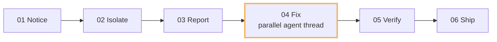

# StudioMCP

An independent, local-only MCP bridge for Koikatsu Studio and Koikatsu Sunshine Studio.
It consumes installed plugins' public APIs; it does not patch Material Editor source or save formats.

<a href="https://tomtom1010-iee.github.io/KK_StudioMCP/"></a>

**The final piece.** Connect asset preparation to actual in-game rendering, then bring the result
back into the next decision. **[Open the ecosystem showcase →](https://tomtom1010-iee.github.io/KK_StudioMCP/)** · [中文](https://tomtom1010-iee.github.io/KK_StudioMCP/#zh)

**[0.2.0 RC1 downloads](https://github.com/tomTom1010-IEE/KK_StudioMCP/releases/tag/v0.2.0-rc1)**:
Host plus ONE matching KKS/KK bridge. This is a public pre-release. [Install/upgrade](docs/Installation.md),
[RC acceptance](docs/RC1-Acceptance.md), [release notes](docs/ReleaseNotes-0.2.0-rc1.md) and
[dependency notices](THIRD-PARTY-NOTICES.md).

## Showcase

The [ecosystem showcase](https://tomtom1010-iee.github.io/KK_StudioMCP/) walks through the
0.1.0 RC1 release in thirteen chapters, in English and Chinese: the creative loop, the shared
foundations, in-game render evidence, and the credits and licenses. Four of its stops:

<table>
  <tr>
    <td width="50%" valign="top"><a href="https://tomtom1010-iee.github.io/KK_StudioMCP/#ch-07"></a><br><b>07 · CrystalFantasy</b><br>Six views of one scene: materials, composition and camera work.</td>
    <td width="50%" valign="top"><a href="https://tomtom1010-iee.github.io/KK_StudioMCP/#ch-08"></a><br><b>08–09 · Greenhouse</b><br>Test a glass hypothesis in fixed views, then compare before and after.</td>
  </tr>
  <tr>
    <td width="50%" valign="top"><a href="https://tomtom1010-iee.github.io/KK_StudioMCP/#ch-10"></a><br><b>10 · Self-iteration</b><br>Building a scene exposed a TomProbe bug; a parallel agent thread fixed it the same day.</td>
    <td width="50%" valign="top"><a href="https://tomtom1010-iee.github.io/KK_StudioMCP/#ch-11"></a><br><b>11 · Material detail</b><br>From a finished view down to puddle and wet-film materials.</td>
  </tr>
</table>

### Build the scene, fix the foundation

While lighting Rainline, the agent saw reflections that missed the sky, traced them to TomProbe
0.2.1 and wrote a fix brief. A parallel agent thread shipped TomProbe 0.2.2 from it, and the first
agent verified the repair in the same scenes and cameras, on the same day.



[See the loop, the before/after comparison and the other foundation fixes →](https://tomtom1010-iee.github.io/KK_StudioMCP/#ch-10)

## Start here: agents and shader authoring

Read the [agent guide](docs/Agent-Guide.md) before editing a scene. For TomX, TomBSDF or V+ LTS
materials, follow the [RenderDocs routing guide](skills/studiomcp-shader-authoring/references/shader-renderdocs.md)
to find the matching project's documentation and understand its lighting, texture channels, units,
transparency and limitations before choosing values. MCP property introspection is not a shader manual.

The portable [studiomcp-shader-authoring skill](skills/studiomcp-shader-authoring/SKILL.md) carries
that workflow for agents without this repository or any earlier conversation in context. Copy the
complete skill folder into your agent's configured skill directory, reload it if needed, then invoke
`$studiomcp-shader-authoring`. It requires no separately installed skill. A client without skill
support can read the agent and routing guides directly. Connecting the MCP server alone does not
automatically load external RenderDocs into the model's context.

Starting from a new machine? The separate
[scene-pipeline setup package](https://github.com/tomTom1010-IEE/TomBSDF/releases/tag/scene-pipeline-setup-20261027)
covers Blender, the matching Unity template/Editor bridge and StudioMCP installation. Modern TomX
and TomBSDF are KKS-first; a functioning KK connection is not proof of their KK compatibility.

See the [release-readiness checklist](docs/Release-Readiness.md) for the reviewed source boundary,
remaining binary-distribution work and unqualified runtime cases. Documentation is not authorization
to deploy, replace a scene, rebuild shaders or run the live integration scripts.

## Character posing and animation

Version 0.2.0 RC1 adds native Studio FK/IK controls, KKPE fine bones and blendshapes, and native
Timeline track/keyframe editing. KKPE and Timeline remain optional; playback and save data stay
with their original plugins. See [Character Animation](docs/Character-Animation.md) for tools,
coordinate frames, bindings and verification. Update both the host and bridge, then refresh the
client's tool list to see all 60 tools. The older 0.1.0 RC1 packages expose 40 tools.
The new animation tools passed KKS live checks; KK is currently build-verified only.

## Current verified state

- Original KoikatuMCP + KKStudioSocket built and exercised in a real KKS process: scene tree,
  catalog item creation, saved object transforms, camera changes, and MCP PNG image content.
- Independent KKS bridge and MCP 2.3.0 host built and exercised in the same installation.
- ME color and float writes were read back from the material using ME's scene-controller API.
- Screencap produced real 640x360 PNGs with its pre/post-capture hooks and temporary-resource cleanup.
- The agent inspected a red sphere, changed it to blue, tightened the camera, and inspected the next
  returned MCP image. The integration verifier also checked the two rendered color regions.

- KKS extended verification passed: Character/Hair/Clothing/Accessory scopes; item and clothing
  texture import; Float/Color and texture persistence after scene reload; batch prevalidation and
  undo; native render settings; checkpoint restore; stale-session rejection; and 3840x2160 Screencap.

- KK passed the same extended checks against its actual Unity 5.6 / Mono runtime.
  Its bridge targets .NET 3.5; KKS targets .NET 4.6. Shader introspection on KK uses ME metadata.

All interaction and verification uses PowerShell, MCP, game APIs and exported image files.
No mouse/keyboard automation, computer-use tools, or desktop capture is used.

## Scene authoring extensions

The Rainline KKS showcase adds native light creation and light-layer control, saved ME shader
selection, camera orbit distance, reflection/SH diagnostics, and paired color/depth export through
the installed OfflineReShade-capable Screencap. Opt-in environment settings and light overrides
are embedded in the native scene PNG through KKAPI/ExtendedSave; a checkpoint sidecar is no longer
the only copy. Loading a scene requires this bridge to restore those extra settings, but does not
require an MCP host connection or write-enabled server.

See [the scene authoring change record](docs/rainline-authoring.md) for dependencies, persistence
boundaries and the KKS-only qualification of these new features. The previous KK verification
above does not qualify these later additions on Unity 5.6.

The four-weather Rainline extension adds native Studio AO, bloom, fog, DOF and character-light
controls, native sky selection, reloadable panoramic sky binding, saved texture tiling and object
visibility. It uses the existing game effect components, not PPE, a filter item or a replacement
postprocessing stack. See [the weather authoring record](docs/rainline-weather.md).

## Structure

- `src/StudioBridge`: .NET Framework BepInEx bridge. All Unity access executes on the main thread.
- `src/StudioMcp.Host`: standalone .NET 8 stdio MCP server; the MCP SDK is not loaded into Unity.
- `tools/mcp_client.py`: stdio protocol verifier, including actual image-content decoding.
- `tools/verify_mvp.py`: live ME/Screencap closed-loop verification.
- `tools/verify_extended.py`: live character, texture, batch, checkpoint and 4K verification.
- `tools/deploy.ps1`: installs only the bridge's own plugin directory and backs up replaced files.
  It only closes processes carrying the test harness's own launch marker.
- `tools/package.ps1`: clean-source, locked-dependency, edition-isolated RC packaging; no deployment.
- `tools/audit_packages.py`: ZIP/provenance/dependency/hash audit without loading game code.

References, credentials, build output, generated images and local evidence are git-ignored.

## Build and install

```powershell
dotnet build src/StudioMcp.Host/StudioMcp.Host.csproj -c Release
./tools/deploy.ps1 -GameRoot '<KKS installation>' -Game KKS -Launch -EnableWrites
# For Koikatsu, use its installation path and -Game KK instead.
```

Source builds need a compatible .NET SDK and matching Framework reference/game assemblies. The
external host needs .NET 8; the game bridge uses its matching game Mono, not .NET 8. KK/KKS bridge
outputs now live separately under src/StudioBridge/bin/Release/KK or KKS. Product versioning comes
from Directory.Build.props; do not confuse MCP SDK package version with the bridge's version.

The bridge defaults to read-only. The test launcher enables writes only in the launched process's
environment. For ordinary use, explicitly enable `Server.AllowWrites` in the bridge configuration.
The listener binds to loopback and requires a generated token. Do not share `connection.json`.

Configure an MCP client to run `dotnet` with the built `StudioMcp.Host.dll`. Set
`STUDIOMCP_CONNECTION` to `<game>/UserData/StudioMCP/connection.json`.
Read `studio_status` or `scene_snapshot` first; writes must include that scene's `sceneSession`.

For dense scene imports, the host accepts `STUDIOMCP_REQUEST_TIMEOUT_SECONDS` (integer 5-180,
default 35). This only changes the host's bounded response wait; it does not extend the game's
30-second queue admission deadline or interrupt a Unity operation already executing. After a
timeout, inspect the live state before retrying a write. The Procedural Paradise greenhouse
required a longer wait when ME switched a material shared by over 1,000 renderers. No game DLL
or ME persistence changes are required for this host-only option.

A typical client configuration is:

```json
{
  "mcpServers": {
    "studio": {
      "command": "dotnet",
      "args": ["<absolute repository path>/src/StudioMcp.Host/bin/Release/net8.0/StudioMcp.Host.dll"],
      "env": {"STUDIOMCP_CONNECTION": "<game>/UserData/StudioMCP/connection.json"}
    }
  }
}
```

See [capabilities and boundaries](docs/capabilities.md) and [live verification](docs/verification.md).

## Research baseline

- KKStudioSocket: `https://github.com/great-majority/KKStudioSocket`,
  commit `ee47ca555ff2764d69ea41a46e8fb4dbaf436e25`, GPL-3.0.
- KoikatuMCP: `https://github.com/great-majority/KoikatuMCP`,
  commit `d17c27006f8d9f7f45861e0fe77ee3db5518adab`, MIT.

These projects demonstrated the Studio API and image-return path. The independent bridge uses a
separate plugin GUID, authenticated endpoint, bounded dispatch and the installed ME/Screencap APIs.
Research clones live under `.references/` and are not included in this repository.

StudioMCP is licensed under AGPL-3.0, retaining the destination repository's existing LICENSE.
Dependency and reference-project licenses remain applicable.

Credits and licenses for the showcase are in [its last chapter](https://tomtom1010-iee.github.io/KK_StudioMCP/#ch-13).
